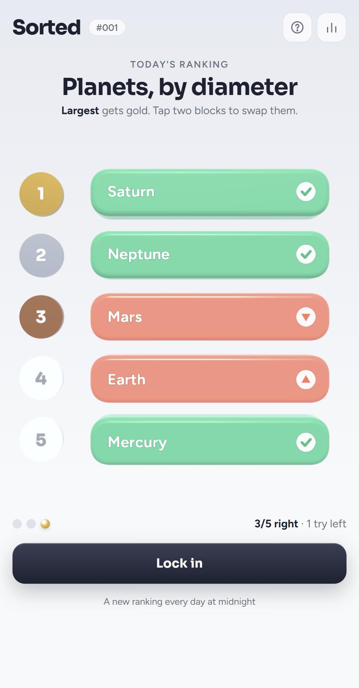

<div align="center">

# Sorted

**Five things. Three tries. One right order.**

A daily ranking puzzle on a glossy 3D board.

[**▶ Play today's puzzle**](https://sharmishtha-b.github.io/sorted/)




</div>

<br>

## How it works

Every day there's one category, like *Planets, by diameter* or *Bollywood films, by release year*, and five entries to rank. Gold medal at the top.

Swap blocks around, hit **Lock in**, and each block tells you something:

| | |
|:-:|---|
| ✅ | Right place. Leave it. |
| 🔼 | Belongs higher. |
| 🔽 | Belongs lower. |

It never tells you *how far* to move. You get three tries.

When you're done, share your result without spoilers:

```
Sorted #001 · 2/3
Planets, by diameter
🔼🟩🔽🔽🔼
🟩🟩🟩🟩🟩
```

## What's inside

- **100 hand-picked lists** across space, geography, nature, science, food, film, music, sport, history and tech. That's over three months without a repeat.
- **One shared puzzle a day** for everyone, with a countdown to the next one.
- **Stats that stick:** games played, win %, current and best streak, and how many tries your wins usually take.
- **Bonus rounds** for when one a day isn't enough.
- **Real-time 3D:** glossy blocks, gold, silver and bronze medals, swap and flip animations, and confetti when you get it.
- **Works everywhere:** desktop and phone. On a keyboard, press two numbers from 1 to 5 to swap those ranks.

## Under the hood

The whole game is one `index.html`: vanilla JavaScript, CSS and [Three.js](https://threejs.org/) loaded from a CDN. There's no framework, no build step and no backend.

- **Daily puzzle:** the day number is counted from launch day, then looked up in a fixed shuffle of all 100 lists. Everyone gets the same puzzle, and similar topics don't land back to back.
- **Feedback:** each block compares its position to its true rank, so you get ✓, ▲ or ▼.
- **Progress and stats** are kept in `localStorage`, so they live in your browser.

### Run it locally

```bash
git clone https://github.com/Sharmishtha-b/sorted.git
cd sorted
python -m http.server 8000
```

Then open http://localhost:8000.

### Add a list

Each puzzle is one line in the `PUZZLES` array in `index.html`, written in the correct order:

```js
{ q: 'Planets, by diameter', dir: '<b>Largest</b> gets gold', items: [['Saturn', '116,460 km'], ['Neptune', '49,244 km'], ['Earth', '12,742 km'], ['Mars', '6,779 km'], ['Mercury', '4,879 km']] },
```

A good list has five well-established values that are clearly far apart. Values marked `~` are approximate.

## About the data

The numbers come from widely published figures. Some things, like populations, weights and record lifespans, vary by source and year, so those are marked `~`. If you spot something off, [open an issue](https://github.com/Sharmishtha-b/sorted/issues).

## Built with

Made by [Sharmishtha Bharti](https://sharmishtha-portfolio.vercel.app) as a weekend side project, with Claude (Anthropic) as an AI pair programmer. I set the direction and made the design and gameplay calls; Claude helped write the code.

## License

[MIT](LICENSE)
